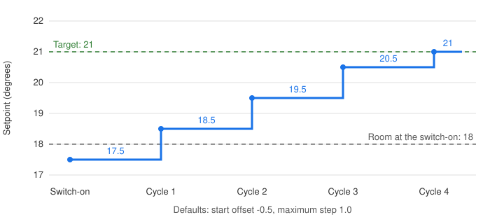

# Gentle Start documentation

Gentle Start is a plugin for [Versatile Thermostat](https://github.com/jmcollin78/versatile_thermostat) (VTherm). It makes an `over_climate` thermostat start a device gently: the device receives a setpoint close to the room temperature, which then moves towards the target by a limited step per cycle.

| Page | Read it to |
| --- | --- |
| [Installation](installation.md) | Install the plugin with HACS or by hand, and remove it. |
| [Configuration](configuration.md) | Add the plugin to a thermostat and choose the start offset and the maximum step. |
| [How it works](how-it-works.md) | Understand the ramp, the slope guard and how the plugin works with the regulation of VTherm. |
| [Attributes and sensor](attributes-and-sensor.md) | See what the plugin exposes: the `gentle_start` attributes, the adjustment sensor and a dashboard badge. |
| [Reducing API calls](reducing-api-calls.md) | Count the commands sent at each switch-on and reduce them for a device behind a cloud service with a request quota. |
| [Troubleshooting](troubleshooting.md) | Check that the plugin is active, find out why it is not, and enable the debug log. |
| [Limitations](limitations.md) | Know what the plugin does not do, and what has and has not been tested. |
| [Development](development.md) | Run the tests, rebuild the brand images and make a release. |

The [changelog](../CHANGELOG.md) lists what changed in each release.

## In one minute

1. Install the plugin with HACS and restart Home Assistant ([Installation](installation.md)).
2. Add the **Versatile Thermostat Gentle Start** integration, pick an `over_climate` thermostat and keep the defaults ([Configuration](configuration.md)).
3. Switch the thermostat on. Its `gentle_start` attribute shows `ramp_value`, the setpoint sent to the device, rising towards `ramp_target`, the regulated temperature of VTherm ([Attributes and sensor](attributes-and-sensor.md)).

