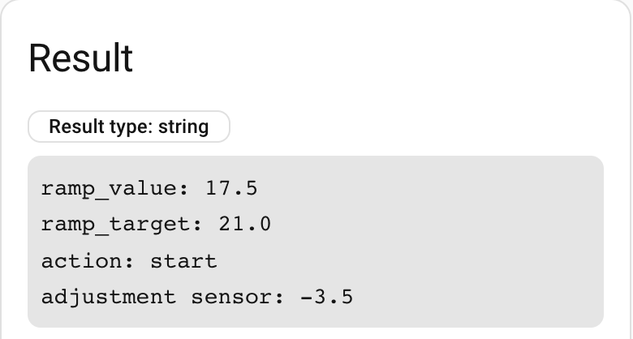
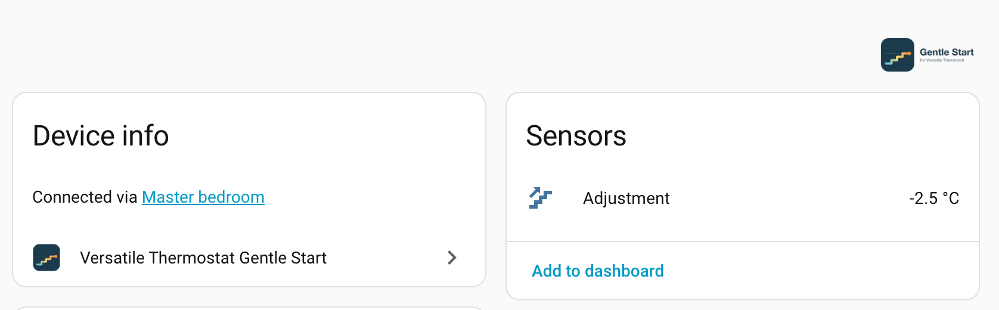
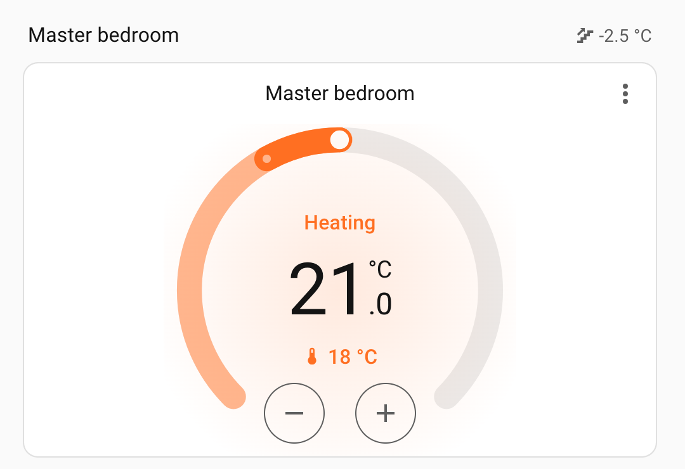
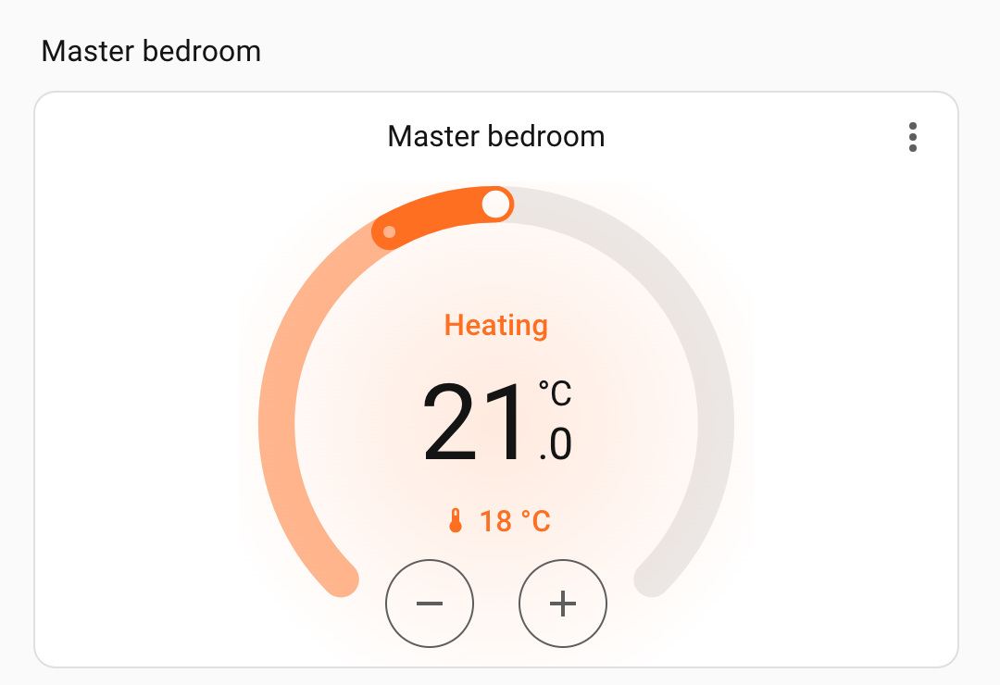

# Attributes and sensor

## Attributes of the thermostat

A thermostat which has the plugin shows a `gentle_start` section in its attributes. A thermostat without the plugin shows nothing extra. All values live under this one key because the recorder can only filter top-level attributes.

| Attribute | Meaning |
| --- | --- |
| `start_offset` | The option of the entry. |
| `max_step` | The option of the entry. |
| `ramp_value` | The setpoint the ramp currently sends. Empty when no ramp is in progress. |
| `ramp_target` | The regulated temperature the ramp is heading for. Empty when no ramp is in progress. |
| `action` | What the ramp did at its last step: see below. |

The values can be read in **Developer tools, Template**, for example while a ramp is in progress:



The `regulated_target_temperature` attribute of the thermostat itself shows the adjusted setpoint, which is the same as `ramp_value`. It cannot be used to see what the ramp is heading for: use `ramp_target`.

Values of `action`:

| Action | Meaning |
| --- | --- |
| `start` | The ramp has just started. |
| `up` | The setpoint moved one step towards the regulated temperature. |
| `reached` | The setpoint is the regulated temperature. |
| `hold` | The slope guard held the setpoint. |
| `down` | The demand was lowered: the setpoint went down when heating, and up when cooling. |

## The adjustment sensor

Each entry also creates a sensor, named after the thermostat. For a thermostat named "Master bedroom" the entity id is `sensor.master_bedroom_gentle_start_adjustment`. Home Assistant shows it as "Master bedroom Gentle Start Adjustment", and as "Adjustment" on the page of its device. Confirm the id of your sensor in **Developer tools, States**.

Home Assistant keeps one device per integration entry, so the sensor is on its own device, `<thermostat> Gentle Start`, which is shown as connected to the thermostat. Removing the entry removes the sensor and its device.

* **State.** `ramp_value` minus `ramp_target`, in degrees, rounded to one decimal: how far the ramp is holding the setpoint back.
* **No adjustment.** The state is `0.0` when no ramp is in progress or when the ramp has reached the regulated temperature.
* **Unknown.** The state is unknown when the thermostat is unavailable or does not publish the `gentle_start` section, for example when the plugin is not attached to it yet ([Troubleshooting](troubleshooting.md)).
* **Attribute.** `action` repeats the last step of the ramp.
* **Unit.** The temperature unit of Home Assistant.



Icons follow the direction of the ramp:

| Situation | State | Icon |
| --- | --- | --- |
| Heating, the setpoint rises towards the regulated temperature | negative | `mdi:stairs-up` |
| Cooling, the setpoint falls towards the regulated temperature | positive | `mdi:stairs-down` |
| No adjustment | `0.0` | `mdi:stairs` |

The sensor has no state class, so it is not recorded as a long-term statistic.

## A badge for a dashboard

To show the sensor only while the ramp is adjusting, add it as a badge of a heading card, hidden when it is `0.0`. Replace the entity id with the one of your sensor.

```yaml
type: heading
heading: Master bedroom
badges:
  - type: entity
    entity: sensor.master_bedroom_gentle_start_adjustment
    visibility:
      - condition: state
        entity: sensor.master_bedroom_gentle_start_adjustment
        state_not:
          - "0.0"
          - unknown
          - unavailable
```

While the ramp is adjusting, the badge shows the stairs icon and the adjustment:



When the ramp has reached the regulated temperature, the sensor is `0.0` and the badge is hidden:



The `visibility` option of heading badges depends on the version of the Home Assistant frontend. If the badge is always shown, update Home Assistant or remove the `visibility` block.

## Using the values in an automation or a template

```yaml
{{ state_attr('climate.thermostat_bedroom', 'gentle_start').ramp_value }}
{{ state_attr('climate.thermostat_bedroom', 'gentle_start').action }}
```

An automation can, for example, notify when `action` becomes `hold` for a long time, which may mean that the room temperature is already close to the target.
