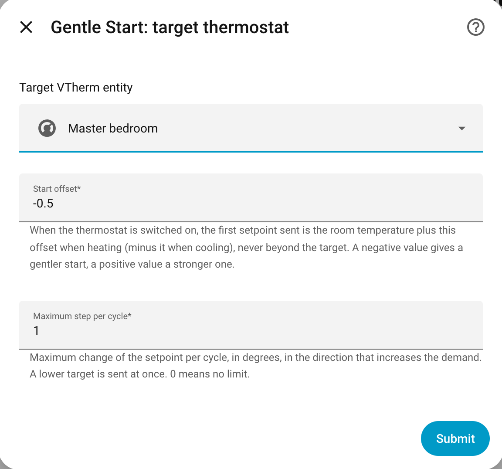
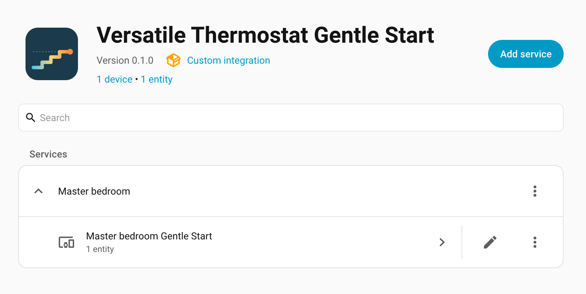
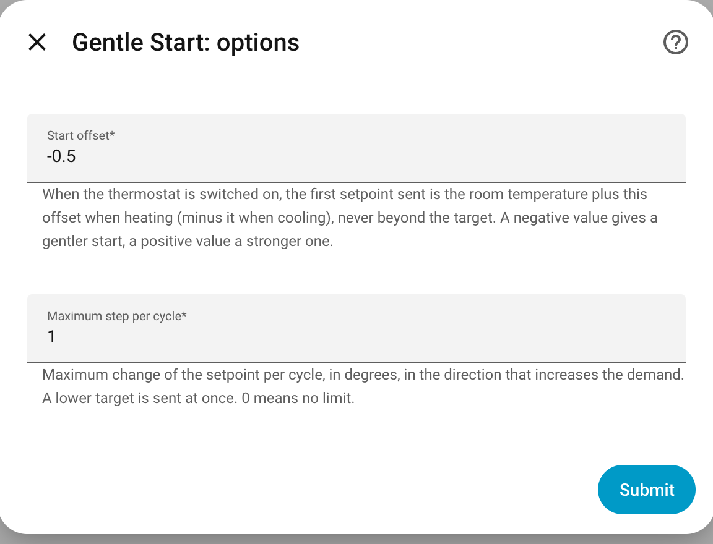

# Configuration

Add the **Versatile Thermostat Gentle Start** integration from **Settings, Devices and services**, then pick the `over_climate` thermostat and set the two options.

One entry is created per thermostat. A thermostat without an entry is not ramped and shows no extra attribute. The integration page lists each entry with its device.

* Adding or deleting an entry reloads that thermostat, so that it takes the change up at once. Nothing else needs a restart. Releases up to `0.0.2` need one when the thermostat is your only Versatile Thermostat entry (see [Limitations](limitations.md)).
* The options can be changed later with **Reconfigure**, from the menu of the entry. VTherm reads them when it needs them, so nothing is reloaded.

* Only `over_climate` thermostats without direct valve regulation are offered. A direct valve regulation drives the valve opening, not a setpoint.

## Options

| Option | Default | Meaning |
| --- | --- | --- |
| Start offset | -0.5 | When the thermostat is switched on, the first setpoint sent is the room temperature plus the offset when heating, minus the offset when cooling, never beyond the target. A negative value gives a gentler start, where the device sees a small difference. A positive value gives a stronger start. |
| Maximum step per cycle | 1.0 | Maximum change of the setpoint per cycle, in degrees, in the direction that increases the demand: upwards when heating, downwards when cooling. A lower target is sent at once. 0 means no limit. |

The values are in the temperature unit of Home Assistant.

## Choosing the values

* **Gentler start.** Use a more negative offset, such as -1.0, and a small step, such as 0.5. The device sees a small difference for longer. The cost is more commands: see [Reducing API calls](reducing-api-calls.md).
* **Faster start.** Use an offset of 0 or a positive value, and a larger step such as 2.0. A step of 0 removes the limit, so the setpoint goes to the target at the next cycle, and only the first setpoint is gentle.
* **The step has a floor.** The maximum step is never lower than the regulation step of the thermostat (the regulation delta, or the target temperature step if it is 0), because the rounding would otherwise cancel each change. A warning is logged once when the step is raised.
* **The cycle.** A step is taken once per cycle of the thermostat (`cycle_min`). A longer cycle makes a slower ramp, and a shorter one a faster ramp, for the same step.

For the effect of these values on the setpoints sent, see [How it works](how-it-works.md).

## Settings of the thermostat which also matter

The plugin leaves the regulation of VTherm in charge, so these settings of the thermostat keep their usual effect on the adjusted setpoint:

* `cycle_min`: the time between two steps.
* `auto_regulation_periode_min`: the minimum time between two regulations. When it is longer than the cycle, the slope guard looks as far ahead as this period.
* `auto_regulation_dtemp`: a change smaller than this is not sent. Keep the maximum step at or above it, or whole steps are dropped.
