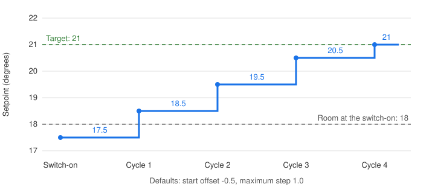

# How it works

Without the plugin, VTherm sends the regulated temperature to the device as soon as it is switched on. A heat pump then sees a large difference between its setpoint and the room and starts hard. With the plugin, the setpoint is held back and released in steps.

The plugin never competes with VTherm. It receives the regulated temperature which VTherm is about to send, after the self-regulation, and returns the setpoint to send instead. It can delay the rise of the setpoint, hold it or lower it. It never returns more than the regulated temperature when heating, or less when cooling.

## The ramp

The room is at 18 degrees and the target is 21 degrees. With the defaults, heating sends 17.5 when it is switched on, then 18.5, 19.5, 20.5 and 21 on the following cycles, one step per cycle. With a start offset of 1.0 and a step of 0.5 it sends 19, 19.5, 20, 20.5 and 21.

Cooling is the mirror. The room is at 26 degrees and the target is 23 degrees. With the defaults it sends 26.5, 25.5, 24.5, 23.5 and 23.

* **Start.** The first setpoint is the room temperature plus the start offset when heating, minus it when cooling, never beyond the target.
* **Steps.** Once per cycle the setpoint moves towards the target by at most the maximum step.
* **Reached.** When the setpoint equals the regulated temperature, the ramp is complete and the setpoint then follows VTherm as usual.
* **A lower demand is applied at once.** If VTherm asks for less than the ramp holds (a lower target, for example), the setpoint is lowered to it immediately, not step by step.

### When the ramp starts

* **Before the device switches on.** When the device is off, the start setpoint is sent to it before it is switched on, so that it does not start from its own stored setpoint. This is a command sent to the device, not a confirmation that the device applied it.
* **At each switch-on.** The ramp starts again each time the thermostat is switched on. The plugin watches the state of the thermostat, so a quick off and on is seen too. It also starts again when the thermostat changes between heat and cool.
* **Not when the device only goes idle.** The ramp is not restarted when the device reaches the target and idles while the thermostat stays on.
* **After a restart of Home Assistant.** A ramp in progress resumes where it was.
* **Changes made on the device.** A change made on the device itself, which VTherm follows, is not ramped.
* **Modes.** The ramp applies in the `heat` and `cool` modes only. In any other mode, and when the room temperature is unknown, VTherm sends its setpoint unchanged.

## Following the room temperature

The plugin uses the slope of the room temperature which VTherm already computes from the sensor, the `temperature_slope` attribute of the thermostat, in degrees per hour. It does not measure anything itself.

* VTherm updates the slope at each reading of the sensor, and when the sensor is silent for 30 minutes it adds a flat point. A sensor which only reports changes can therefore leave a slope in place for a while.
* The slope is not used during the first two cycles of a ramp, because right after a switch-on it still describes the room before the heating.
* When the slope is unknown, the ramp is the plain ramp above.

At each step, one per cycle, the plugin predicts the room temperature at the next adjustment: the temperature now plus the slope times the time to the next adjustment. That time is the cycle, or the regulation period of the thermostat if it is longer. The limit is the target temperature of the thermostat, not the regulated setpoint, which the self-regulation can set higher.

| Prediction | Result |
| --- | --- |
| The room is not predicted to pass the target. | The setpoint rises by one step, as above. |
| The room is predicted to pass the target by less than one regulation step. | The setpoint is held where it is. |
| The room is predicted to pass the target by one regulation step or more. | The setpoint is lowered by one step, or by one regulation step when there is no limit per cycle. It never goes below the gentlest level: the room temperature plus the start offset when the offset is negative, and the room temperature otherwise. |

When the prediction is back under the target, the setpoint rises again by one step per cycle.

In cool mode everything is inverted around the room temperature. The start setpoint with a negative offset is above the room, the setpoint goes down towards the target, and it is never below the regulated temperature. A room which falls fast towards the target gets a higher setpoint, never above the room temperature minus the offset when the offset is negative (the room temperature otherwise). For example, with a target of 23 and the defaults, a room at 23 which falls by one degree per cycle gets 23.5 instead of 23.

The prediction looks one adjustment ahead. It cannot cancel an overshoot which comes from a long delay in the heating system. It makes the device ease off a little earlier than it would, and it does not remove such an overshoot.

## Working with the regulation of VTherm

* The plugin adjusts the regulated temperature after the self-regulation, and never competes with it.
* The regulation period, the regulation delta and the cycle of the thermostat keep their usual effect on the adjusted setpoint.
* A held setpoint is the one last sent, so VTherm sends nothing: holding costs no command.
* A change made on the device itself is followed by VTherm as before, and is not adjusted.
* The plugin only adjusts the setpoint. It does not switch a device on or off, and it does not change the target, the mode or the presets of the thermostat.
